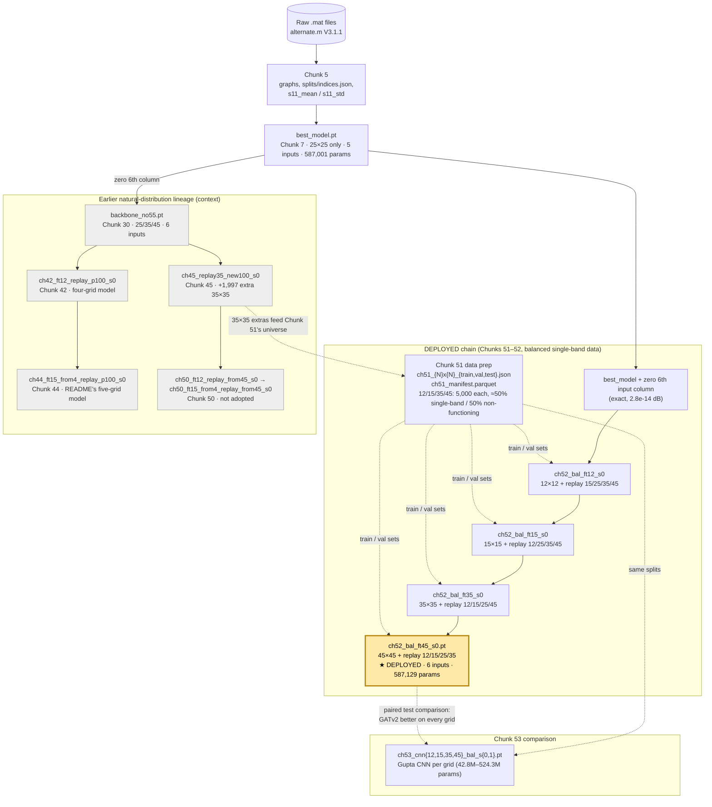
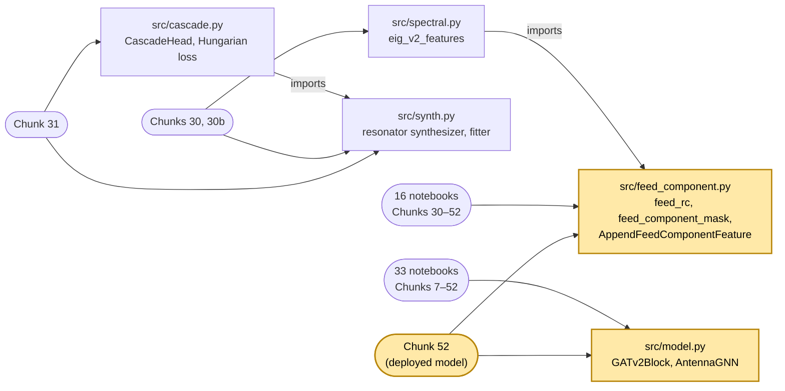
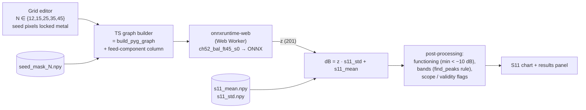

# Repository map

The human-readable companion to [`graph.json`](graph.json) (one node per file, each with a hand-written summary, plus imports / reads / writes / produces / precedes edges). Regenerate the graph with `make graph` (or `python scripts/repo_graph/build_graph.py`); `make graph-check` fails if a tracked file is missing, the graph is stale, or a summary is missing or out of date. See the `repo-graph` skill for the update procedure.

- **Code:** `src/` (5 modules), `scripts/repo_graph/build_graph.py`, and `export/` (the Python reference pipeline for the web app: `antenna_export.graph_builder` holds the frozen `build_pyg_graph` verbatim plus `pattern_to_graph`; tests in `export/tests/`, run with `make py-test`).
- **Research log:** `notebooks/` (50 notebooks, Chunks 1–53 plus 3 unnumbered). They ran on Colab/Kaggle against a Google Drive tree (`{DATA_ROOT}/artifacts`, `checkpoints/`, `splits/`, `data/processed/`), which is **not** in the repository; local copies of what the web app needs are in `webapp_private/` (ignored, never committed).
- **Web-app working files:** `CLAUDE.md`, `PROGRESS.md`, `DEBUG_LOG.md`, `.claude/skills/*`, `.githooks/pre-commit`.
- **Golden fixtures (the cross-layer contract):** `webapp/fixtures/{N}x{N}.json`, generated only by `export/scripts/make_fixtures.py` from the float64 reference predictor; each case holds the pattern, the exact 6-feature graph, `expected_z`, `expected_db` and `predicted_bands`.
- **Note:** `README.md` predates Chunks 51–53. Its "final five-grid model" (`ch44_ft15_from4_replay_p100_s0`) is **not** the deployed model; the web app deploys `ch52_bal_ft45_s0`.

---

## 1. Model lineage

The deployed chain is highlighted. Chunk 51 prepares its data, Chunk 52 trains it, Chunk 53 compares it with per-grid CNNs. The natural-distribution lineage (grey) is shown for context: it is where the replay recipe came from, but the deployed chain does **not** descend from it (Chunk 52 restarts from `best_model.pt`, because Chunk 51's new test sets overlap the earlier 12/15/35/45 training pools).

**Deployed model test results** (Chunk 52, `ch52_bal_ft45_s0`; balanced Chunk 51 test sets of 500, 25×25 natural test set of 9,983):

| Grid | MSE (dB²) | MAE (dB) | Gupta CNN MSE (Chunk 53) |
|---|---|---|---|
| 12×12 | 1.936 | 0.495 | 2.287 |
| 15×15 | 1.692 | 0.454 | 2.784 |
| 25×25 | 1.426 | 0.393 | n/a (natural data) |
| 35×35 | 0.988 | 0.314 | 1.689 |
| 45×45 | 1.087 | 0.310 | 1.677 |

**Recipe** (Chunk 52, from Chunks 30/42/44/50): Adam lr 1e-4, weight decay 1e-4, batch 64, gradient clip 1.0, ReduceLROnPlateau (0.5, patience 5), early stopping patience 10, ≤ 60 epochs; each epoch = the target grid's 4,000 training antennas + 4,000 replay draws from each other grid; selection on the target grid's val MSE; seeds 0 and 1 (seed 0 deployed).

Side branches not drawn (none feed the deployed model): CNN baselines (Chunks 3, 36, 37, 42, 44, 49), fine-tune strategy and active learning (13–15), loss surgery / classification head / asymmetric loss (22–27), cascade resonance head (29–31).

---

## 2. `src/` module dependencies

Only `model.py` and `feed_component.py` matter for the web app (highlighted). Notebooks import modules by bare name after `sys.path.insert(0, 'src')` (`from model import AntennaGNN`). `model.py` needs `torch_geometric` (GATv2Conv, global_mean_pool); `feed_component.py` and `spectral.py` need `scipy`.

---

## 3. Web-app data flow (planned, C1–C5)

---

## 4. Notebooks

`chunk` is the number in the filename; `→` marks a checkpoint lineage. Drive artifacts are listed by file name.

| Chunk | Notebook | Purpose | Key outputs |
|---|---|---|---|
| 1 | `chunk01_data_exploration` | Raw data statistics; derive seed masks | `seed_mask_{25,35,45,55}.npy`, figures |
| 2 | `chunk02_graph_construction` | NetworkX graph prototype (global node is_seed = 0 here; PyG builders use −1) | figures |
| 3 | `chunk03_cnn_baseline` | CNN baseline on 25×25 (6.2M params) | `cnn_best.pt`, `cnn_split_indices.json` |
| 4 | `chunk04-pyg-foundations` | First `build_pyg_graph`; PyG smoke tests | none |
| 5 | `chunk05_build_dataset` | All graphs (25/35/45/55), joint split, S11 statistics | `processed_{N}x{N}.zip`, `indices.json`, `s11_mean.npy`, `s11_std.npy` |
| 6 | `chunk06_model_architecture` | Define AntennaGNN; writes `src/model.py` | `src/model.py` |
| 7 | `chunk07_training` | Train the 25×25 base model | `best_model.pt` |
| 8 | `chunk08_evaluation` | GNN vs CNN on 25×25 test (MAE 0.3742 vs 0.3913) | evaluation CSVs |
| 9 | `chunk09_attention_visualization` | Last-layer attention heatmaps | figures |
| 10 | `chunk10_path_analysis` | Path length vs frequency; attention ablation | `path_length_data_25x25.csv` |
| 11 | `chunk11_latent_analysis` | UMAP latent space, gain vs geometry | embeddings `.npy` |
| 12 | `chunk12_finetune_data_prep` | Fine-tune graphs (35/45/55), splits, normalisation contract | `finetune_{pool,val,test}_indices.json`, `finetune_manifest.csv` |
| 13 | `chunk13_transfer_strategy` | Choose fine-tune strategy (A: full, lr 1e-4) | `strategy_{A..D}.pt` (best_model →) |
| 14 | `chunk14_active_learning` | Active learning vs random (pre-contract, unreliable) | `al_curves.csv` |
| 14a | `chunk14a_random_arm_and_power` | Random-arm noise and AL power analysis | `al_model_seed_*_random_r*.pt` |
| 15 | `chunk15_finetuned_evaluation` | Full-pool ceiling fine-tune and evaluation | `ceiling_fullpool.pt` = `gnn_finetuned_multiscale.pt` |
| 17 | `chunk17_path_viz` | Attention-path extraction diagnostics | showcase JSON, figures |
| 20 | `chunk20_dataset_structure` | Dataset audit: percolation vs self-averaging | consolidated `.npz`, features parquet |
| 21 | `chunk21_depth_diagnostics` | Depth under-prediction diagnostics (bias ≈ +4.9 dB) | `ch21_*` |
| 22 | `chunk22_loss_surgery` | Loss ablation (MSE / Huber / weighted MSE) | `ch22_L{0,1,2}.pt` |
| 23 | `chunk23_classification_head` | Multi-task functioning head | `ch23_multitask.pt` |
| 25 | `chunk25_asymmetric_loss_sweep` | Asymmetric-loss κ sweep (2k samples) | `asym_k*_seed*.pt`, `asymmetric_sweep.csv` |
| 26 | `chunk26_frontier_scaleup` | κ frontier at 4k samples (picks κ = 1.5) | `asym_scaleup_k*_seed*.pt` |
| 27 | `chunk27_stratified_reaudit` | Stratified FNR/FPR re-audit | `final_deliverable_choice.json` |
| 27b | `chunk27b_fnr_reconciliation` | Finds Chunk 27's bin-label bug | `fnr_reconciliation_verdict_v2.json` |
| 28 | `chunk28_unified_measurement` | One-pass evaluation of 49 checkpoints | `ch28_per_sample.parquet` |
| 29 | `chunk29_cascade_diagnostics_v2` | Cascade viability gate; 8-connected conductor finding | `ch29_decisions.json` |
| 30 | `chunk30_backbone_targets_cache` | No-55 backbone pipeline (code only, unexecuted) | (see 30b) |
| 30b | `chunk30b_backbone_targets_cache` | Executed: 6-input backbone with 25×25 replay | `backbone_no55.pt` (best_model →), `ch30_*` caches |
| 31 | `chunk31_head_design` | Cascade resonance head on frozen embeddings (gate failed) | `ch31_head_best.pt` |
| 35 | `chunk35_classification_metrics` | Functioning AUROC / balanced accuracy, GNN vs CNN | `ch35_*` |
| 36 | `chunk36_gupta_cnn_25x25` | Gupta CNN at 25×25 (165.9M params) | `ch36_gupta_cnn25_best.pt` |
| 37 | `chunk37_data_efficiency` | GNN vs CNN on 25×25 subsets | `ch37_{gnn,cnn}_n*_s*.pt` |
| 40 | `chunk40_test_mse_per_grid` | Per-grid test MSE; is 45×45 easier? | `ch40_*` |
| 41 | `chunk41_preprocess_12x12` | 12×12 graphs, seed mask, split | `processed_12x12.zip`, `seed_mask_12.npy`, `finetune12_*` |
| 42 | `chunk42_train_test_12x12` | 12×12 fine-tune vs scratch vs CNN | `ch42_ft12_replay_p100_s0.pt` (backbone_no55 →) |
| 43 | `chunk43_preprocess_15x15` | 15×15 graphs, seed mask, split | `processed_15x15.zip`, `seed_mask_15.npy`, `finetune15_*` |
| 44 | `chunk44_train_test_15x15` | 15×15 arms; README's five-grid model | `ch44_ft15_from4_replay_p100_s0.pt` (ch42 →) |
| 45 | `chunk45_replay_finetune_35x35_extra` | 1,997 extra 35×35 antennas; holds the frozen `build_pyg_graph` | `processed_35x35_extra.zip`, `ch45_replay35_new*_s*.pt` (backbone_no55 →) |
| 46 | `chunk46_s11_prediction_figures` | S11 example figures; band rule | `ch46_*`, figures |
| 47 | `chunk47_band_distribution` | Band-count distribution per grid (adds band-edge rule) | `ch47_*` |
| 48 | `chunk48_deep_single_band_figures` | Deep single-band figures (code: −15 dB, 3.50–3.75 GHz) | `ch48_*` |
| 49 | `chunk49_gupta_cnn_35x35_45x45` | Gupta CNN at 35/45; GATv2-vs-CNN table | `ch49_cnn{35,45}_p100_s*.pt` |
| 50 | `chunk50_replay_chain_from_ch45` | 12 → 15 chain rebuilt from Chunk 45 (not adopted) | `ch50_ft15_from4_replay_from45_s0.pt` (ch45 →) |
| **51** | `chunk51_balanced_single_band_data` | **Deployed model's data**: balanced single-band / non-functioning sets | `ch51_{N}x{N}_{train,val,test}.json`, `ch51_manifest.parquet` |
| **52** | `chunk52_balanced_replay_finetune_gatv2` | **Trains the deployed model** | `ch52_bal_ft{12,15,35,45}_s{0,1}.pt`, `ch52_runs.csv` (with SHA-256) |
| 53 | `chunk53_balanced_gupta_cnn` | Gupta CNN vs deployed GATv2 on balanced sets | `ch53_cnn*_bal_s*.pt`, `ch53_*` |
| — | `chunk_prereq_multigrid_cache` | Raw `.mat` → per-grid tensor caches (before Chunk 5) | `raw_cache_{N}x{N}.pt` |
| — | `chunk_seed_stability` | 5-seed stability of Chunk 22/23 findings | `stability/*.pt`, `seed_stability_ch2{2,3}.csv` |
| — | `cleanup_v1_artifacts` | Quarantine invalid v1.0 fine-tune artifacts (before Chunk 12) | `v1_cleanup_report.json` |

---

## 5. Files the web app depends on

**Repository code (authoritative):**

| File | What the app takes from it |
|---|---|
| `src/model.py` | `AntennaGNN` architecture, instantiated as `AntennaGNN(node_feat_dim=6, edge_feat_dim=2, hidden_dim=128, heads=8, edge_dim=16, num_blocks=4, output_dim=201)`; readout pools metal nodes (`x[:,0] > 0.5`) and takes the virtual node (`x[:,3] == -1`). `GATv2Conv` uses PyG defaults: self-loops added, their edge attributes filled with the **mean** of incoming edge attributes, LeakyReLU slope 0.2, concatenated heads. |
| `src/feed_component.py` | 6th node feature: `feed_rc(N) = (round(0.25·N) − 1, round(N/2) − 1)` with MATLAB half-away rounding; 8-connected metal component containing the feed; 0 on the virtual node and when the feed pixel is air. |
| `notebooks/chunk45_replay_finetune_35x35_extra.ipynb` (cell 10) | The frozen `build_pyg_graph`, verbatim from Chunks 5/12 and verified bit-identical on 20 rebuilt 35×35 graphs there. Other copies are equivalent: Chunks 4, 5, 6, 12, 41, 43 differ only in whitespace, comments and `torch.float` vs `torch.float32`; Chunk 29 adds guards for an empty or missing seed mask; Chunk 10's variant omits `y`. |
| `notebooks/chunk51_balanced_single_band_data.ipynb` | Training-data definition and the band rule the classes were built with. |
| `notebooks/chunk52_balanced_replay_finetune_gatv2.ipynb` | Checkpoint format (`model_state`), normalisation (`(y − mean)/(std + 1e-8)` in training, `z·std + mean` at prediction), the 6-input widening, test results. |

**Local private copies in `webapp_private/` (ignored; never commit):**

| File | Role |
|---|---|
| `checkpoints/ch52_bal_ft45_s0.pt` | Deployed weights (key `model_state`); verify against `checkpoint_sha256` in `artifacts/ch52_runs.csv` before export. |
| `artifacts/s11_mean.npy`, `artifacts/s11_std.npy` | (201,) float32 de-normalisation vectors (Chunk 5). |
| `artifacts/seed_mask_{12,15,25,35,45}.npy` | Seed masks (bool N×N); `is_seed` feature and locked-metal pixels. Each includes the feed pixel. |
| `artifacts/ch52_runs.csv` | Run table with checkpoint SHA-256 values. |
| `artifacts/ch51_manifest.parquet`, `splits/ch51_*_test.json` | Test antennas (classes, bands) for golden fixtures. |
| `graphs/{12,15,25,35,45}x*/` | Stored training graphs: the parity reference for the graph builder (C1.1). |

**Graph builder, exact specification** (from `build_pyg_graph`):

- **Nodes:** pixel `(i, j)` (row `i`, column `j`) has index `i·N + j`; one virtual node at index `N²`.
- **Pixel features** `[metal, j/(N−1), i/(N−1), seed_mask[i,j], √((i−r̄)² + (j−c̄)²)/N]`, where `(r̄, c̄)` is the mean of `argwhere(seed_mask)`; virtual node `[0, 0.5, 0.5, −1, 0]`; then the feed-component column appended (6 features). float32.
- **Pixel edges:** for each pixel in row-major order, neighbours in the order right `(0,+1)` dir 0, left `(0,−1)` dir 1, up `(−1,0)` dir 2, down `(+1,0)` dir 3, if inside the grid; `edge_attr = [type, dir]` with type by (source metal, target metal): (1,1) → 0, (1,0) → 1, (0,1) → 2, (0,0) → 3.
- **Virtual edges:** appended after all pixel edges; for each **metal** pixel in row-major order, `virtual → pixel` then `pixel → virtual`, both `[4, 4]`.
- **Edge count:** `4·N·(N−1) + 2·(number of metal pixels)`.
