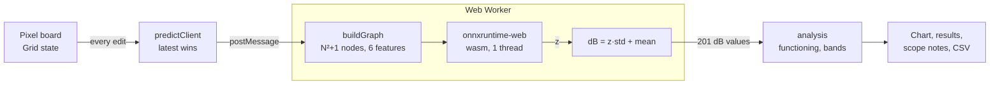

# GraphPatch: the antenna GNN in your browser

**Live: https://asparagusd.github.io/antenna_gnn/**

GraphPatch is a static, client-side web app for the GATv2 surrogate in [`src/model.py`](../src/model.py).
You draw the metal pattern of an N×N pixelated microstrip patch antenna (N = 12, 15, 25, 35 or 45), and the
app predicts its |S11| from 1 to 4 GHz (201 points) on every edit, in your browser. There is no server, no
account and no tracking: the model runs in a Web Worker with onnxruntime-web (single-threaded wasm).

What it shows:

- a pixel board with the seed pixels locked as metal, a fill meter (warning outside 30–80% metal), undo
  and redo, an example antenna per grid and a random antenna;
- the predicted |S11| curve with the −10 dB line, whether the antenna is functioning (minimum below
  −10 dB) and a table of bands (centre, depth, −10 dB bandwidth);
- notes on the model's scope: multi-band predictions and hand-drawn shapes are flagged as outside what the
  model learned;
- share links (the pattern is in the URL hash: `#p=v1.<N>.<base64url bitset>`) and CSV export of the
  curve and the pattern.

The deployed model is `ch52_bal_ft45_s0` (Chunk 52, seed 0): `AntennaGNN(node_feat_dim=6, …)`,
587,129 parameters, exported to [`public/model/antenna_gnn.onnx`](public/model/antenna_gnn.onnx)
(opset 18, 2.47 MB) with [`public/model/meta.json`](public/model/meta.json) (hashes, normalisation
statistics, seed masks, feed pixels, the band rule, the test results per grid).

## Run it

Requirements: Node 24 or later. The Python parts below also need Python 3.12 and
[uv](https://docs.astral.sh/uv/). On Windows, `make` and the shell commands below run in Git Bash.

```bash
git config core.hooksPath .githooks
```

Run that once per clone: the pre-commit hook blocks private data (see below).

```bash
make web-setup
```

Installs the pinned npm dependencies and Playwright's Chromium.

```bash
cd webapp && npm run dev
```

Development server at http://localhost:5173/.

```bash
cd webapp && npm run build && npm run preview
```

Production build in `webapp/dist/`, served at http://localhost:4173/.

| Command (repository root)                       | What it runs                                                                                                                             |
| ----------------------------------------------- | ---------------------------------------------------------------------------------------------------------------------------------------- |
| `make check`                                    | the fast gate: `make check-web` plus `make py-test`                                                                                      |
| `make check-web`                                | TypeScript typecheck, ESLint, Vitest (unit tests and the ONNX parity test in Node), the Impeccable design detector; this is what CI runs |
| `make py-test`                                  | pytest on the Python reference in `export/` (needs `webapp_private/`, see below)                                                         |
| `make e2e`                                      | Playwright end-to-end tests on the production build (Chromium, desktop and phone, axe accessibility)                                     |
| `cd webapp && npm run e2e:live`                 | the same app checks against the deployed site (`LIVE_URL` selects another copy)                                                          |
| `cd webapp && npm run bench:infer`              | inference time per grid in Node                                                                                                          |
| `node webapp/scripts/measure-latency.mjs [url]` | edit-to-result latency per grid in Chromium                                                                                              |
| `node webapp/scripts/measure-startup.mjs [url]` | download size and time to first prediction, cold and warm                                                                                |

Deployment is automatic: a push to `main` that touches `webapp/**` runs
[`.github/workflows/deploy-webapp.yml`](../.github/workflows/deploy-webapp.yml) (checks, build with
`BASE_PATH=/antenna_gnn/`, publish to GitHub Pages). See [`docs/deployment.md`](../docs/deployment.md).

## How it works



| Module (`webapp/src/`)                                  | Role                                                                               |
| ------------------------------------------------------- | ---------------------------------------------------------------------------------- |
| `core/grid.ts`                                          | grid state, seed locking, fill, random patterns                                    |
| `core/graph.ts`                                         | TypeScript port of the frozen Python graph builder plus the feed-component feature |
| `core/infer.ts`                                         | loads the ONNX model, runs it, de-normalises to dB                                 |
| `core/predictServer.ts`, `core/worker.ts`               | the worker: model load, one prediction at a time, latest request wins              |
| `core/predictClient.ts`, `hooks/usePrediction.ts`       | the main-thread side, model status, errors, timing                                 |
| `core/analysis.ts`                                      | functioning verdict and bands (a port of `scipy.signal.find_peaks`)                |
| `core/share.ts`, `core/exportCsv.ts`, `core/history.ts` | share links, CSV, undo and redo                                                    |
| `model/meta.ts`                                         | parses and checks `meta.json`                                                      |
| `components/`                                           | the React UI                                                                       |

The graph is the one the model was trained on: N² pixel nodes plus a virtual node at index N², node features
`[metal, x, y, is_seed, distance to the seed centroid / N, feed component]`, 4-connected pixel edges with
`[type, direction]` attributes and virtual-node edges to metal pixels only. The exact formulas are in the
frozen Python builder ([`export/antenna_export/graph_builder.py`](../export/antenna_export/graph_builder.py))
and are ported line for line.

## The parity contract

The Python reference in [`export/`](../export) is the source of truth: the frozen graph builder, the
feed-component feature and `src/model.py` with the deployed checkpoint, run in float64. It produced the
48 golden fixtures in [`fixtures/`](fixtures) (10 per grid, 8 for 45×45; patterns from the data and random
patterns at 30–80% fill), each with the expected graph and the expected |S11| in dB. Every other layer is
tested against them:

| Layer                                                 | Test                                                                 | Tolerance                                            |
| ----------------------------------------------------- | -------------------------------------------------------------------- | ---------------------------------------------------- |
| Python graph builder vs the stored training graphs    | `export/tests/test_graph_builder.py`                                 | exact                                                |
| ONNX model in Python onnxruntime                      | `export/tests/test_onnx.py`, `export/scripts/export_onnx.py`         | ≤ 1e-4 dB                                            |
| TypeScript graph builder                              | `src/core/graph.test.ts`                                             | exact (float32 features, edge list, edge attributes) |
| TypeScript + onnxruntime-web in Node                  | `tests/node/infer.parity.test.ts`                                    | ≤ 1e-4 dB                                            |
| The deployed app in Chromium (share link in, CSV out) | `e2e-live/live.spec.ts`                                              | ≤ 1e-4 dB                                            |
| Band analysis vs `scipy.signal.find_peaks`            | `src/core/analysis.test.ts` on `fixtures/analysis/band_vectors.json` | exact                                                |

Measured (C8.1): the browser and Node agree with the reference to at most 2.2e-5 dB on all 48 fixtures.
Tolerances are never loosened; a mismatch is a bug. The fixtures change only through
`export/scripts/make_fixtures.py`, and `export/tests/test_fixtures.py` checks that regenerating them
reproduces the committed files byte for byte. Details: [`docs/verification.md`](../docs/verification.md).

## Re-export the model

You need the private data in `webapp_private/` (local only, never committed): the checkpoint in
`checkpoints/`, `artifacts/` (`s11_mean.npy`, `s11_std.npy`, `seed_mask_{N}.npy`, `ch52_runs.csv` with the
checkpoint's SHA-256) and the reference graphs in `graphs/`.

1. Create the Python environment (Python 3.12, pinned torch, PyG, onnx and onnxruntime):

   ```bash
   make py-setup
   ```

2. For a different checkpoint, change `DEFAULT_CHECKPOINT`, `DEFAULT_RUNS_CSV` and `RUN_ID` in
   [`export/antenna_export/predict.py`](../export/antenna_export/predict.py). Loading checks the file's
   SHA-256 against the runs CSV and refuses a mismatch.
3. If the model's outputs change, regenerate the golden fixtures first (they are the reference the export
   is checked against):

   ```bash
   export/.venv/Scripts/python.exe export/scripts/make_fixtures.py
   ```

4. Export to ONNX. The script checks parity on every fixture and exits non-zero above 1e-4 dB:

   ```bash
   export/.venv/Scripts/python.exe export/scripts/export_onnx.py
   ```

5. Write `meta.json` (it records the ONNX file's SHA-256 and size, so always run it after step 4):

   ```bash
   export/.venv/Scripts/python.exe export/scripts/export_meta.py
   ```

6. Check that the example antennas (one functioning single-band fixture per grid) still suit the new model,
   and regenerate them:

   ```bash
   cd webapp && node scripts/make-examples.mjs
   ```

7. Run `make check` and `make e2e`, commit the ONNX file, `meta.json`, the fixtures and the examples
   together with the reason, merge to `main`, then run `npm run e2e:live` on the new deployment.

On Linux and macOS the venv's Python is `export/.venv/bin/python`. The exporter is TorchScript-based
(`--exporter torchscript`, the default); the dynamo exporter fails on PyG's scatter with data-dependent
shapes (recorded in [`DEBUG_LOG.md`](../DEBUG_LOG.md)).

## Private data

`webapp_private/` holds the checkpoint, the normalisation statistics, seed masks, splits and reference
graphs. It is git-ignored, and `.githooks/pre-commit` rejects any staged path under it, any `.pt`, `.pth`
or `.npy` file and any file over 10 MB. What ships publicly is derived from it: the ONNX model, `meta.json`
(including the 201-point statistics and the seed masks) and the fixtures.

## Limitations

- **Scope of the model.** On 12×12, 15×15, 35×35 and 45×45 it was trained only on single-band and
  non-functioning antennas; on 25×25, on the natural data. It was never observed to predict a second band,
  so the app flags multi-band predictions as unreliable.
- **Domain of validity.** The model learned from the generator's random patterns. Hand-drawn shapes may be
  unlike anything in the training data, and the app says so.
- **Accuracy.** Chunk 52 test errors: MAE 0.31–0.49 dB and MSE 0.99–1.94 dB² depending on the grid
  (balanced test sets; natural data on 25×25). The app is a fast surrogate, not a replacement for a
  full-wave simulation of a final design.
- **Grids.** Only 12, 15, 25, 35 and 45; 55×55 is excluded.
- **Speed.** About 14 ms (12×12) to 225 ms (45×45) per prediction on a Ryzen 5 5600X desktop; the first
  visit downloads about 6 MB (2.2 MB model, 3.7 MB wasm runtime). Slower machines and phones were not
  measured. See [`docs/verification.md`](../docs/verification.md).
- **Offline.** There is no service worker: after the first visit the browser's HTTP cache usually lets the
  app open again, but offline use is not guaranteed.
- **Not built yet.** A crosshair readout on the plot; a check on physical phones (touch was tested only in
  emulation).
